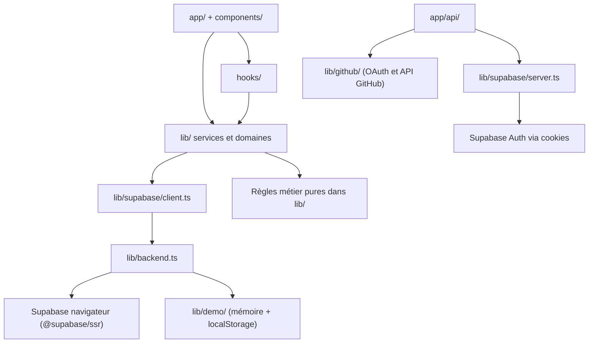
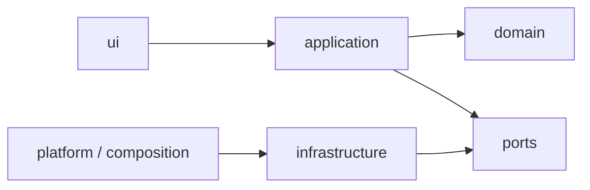

# Architecture de DevNet

## État actuel

DevNet est un monolithe Next.js App Router : les pages et routes vivent dans
`app/`, les composants d'interface dans `components/`, les hooks dans `hooks/`
et les services, modèles et règles partagées dans `lib/`. Le code est en
transition ; cette structure décrit le dépôt actuel, pas encore l'architecture
cible.



### Flux de données

- La plupart des pages utilisent encore le proxy `supabase` et les services
  de `lib/`.   La lecture paginée du fil et la bascule du « J’aime » sont les premiers cas
  d'usage migrés :
    `app/feed` → `lib/social.ts` (façade de compatibilité) →
    `platform/container.ts` → port `FeedRepository` → adaptateur.
- `lib/backend.ts` sonde le backend. Le proxy navigateur choisit le client
  Supabase ou `lib/demo/client.ts`; le backend de démo conserve ses données
  localement et reproduit une partie de l'API utilisée par l'application.
- Les routes API créent leur propre client serveur à partir des cookies HTTP.
  Ce chemin n'est pas le client mémoire du navigateur et peut être indisponible
  sans configuration Supabase.
- L'intégration GitHub est isolée sous `lib/github/` et `app/api/github/`.
  Son flux OAuth utilise un état scellé, un cookie httpOnly et un jeton chiffré.
  Les secrets restent côté serveur.
- Les règles métier pures (progression, notation, preuves, calculs) sont
  distinctes des appels réseau et doivent rester inchangées lors des migrations
  d'architecture, sauf besoin démontré et tests adaptés.

## Limites de l'architecture actuelle

- Le proxy de compatibilité et le backend de démo facilitent le fonctionnement
  en mode démo, mais ne constituent pas encore des ports/adaptateurs formels.
- La logique des services et des vues demeure couplée à l'API Supabase dans
  plusieurs domaines. Le mode mémoire n'est donc pas encore une preuve que
  toutes les fonctions serveur peuvent tourner sans service externe.
- Le mode démo est local au navigateur (notamment `localStorage`) et son bus
  temps réel ne couvre pas plusieurs onglets ou plusieurs instances serveur.
- Les routes qui utilisent les cookies serveur doivent vérifier la session
  côté serveur avant toute action liée à un utilisateur. Les identifiants
  fournis par le navigateur ne sont pas une preuve d'identité.
- Les migrations SQL et leur compatibilité ne sont pas traitées dans cette
  phase. La base Systalink n'étant pas disponible, son moteur, sa version, ses
  droits réseau et ses privilèges restent inconnus.

## Première tranche migrée : fil et « J’aime »

Le domaine `feed` expose maintenant deux cas d'usage derrière le même port :

```text
app/feed
  → lib/social.ts (compatibilité temporaire)
  → platform/container.ts (choix d'adaptateur)
  → modules/feed/application (lecture, enrichissement et bascule du « J’aime »)
  → modules/feed/ports/FeedRepository
  → infrastructure/memory ou infrastructure/supabase
```

- Le contrat est dans `modules/feed/ports/`; il ne contient aucun type SDK.
- `MemoryFeedRepository` s'appuie sur le moteur de démonstration existant.
- `SupabaseFeedRepository` encapsule les lectures et écritures PostgREST. Il
  est transitoire et remplaçable ; la page n'importe aucun SDK.
- Le conteneur choisit la mémoire quand la démo est forcée, sans URL de backend,
  ou quand la sonde a déclaré le backend hors ligne en mode démo.
- Les erreurs de lecture du fil sont typées et affichées avec une action de
  reprise ; elles ne sont pas transformées en liste vide.
- La bascule du « J’aime » garde l'invariant existant : l'insertion d'une ligne
  est tentée en premier, seule une violation d'unicité déclenche son retrait,
  et les autres erreurs ne sont pas interprétées comme un « unlike ».
- Le test de contrat couvre pagination, ordre, portée suivie, cas vide,
  enrichissement, ajout/retrait du « J’aime » et erreurs des deux opérations.

Cette tranche ne déplace pas encore la création/modification/suppression des
publications, les commentaires, les autres domaines ou l'authentification.
`withAuthorXp` reste encore un service de l'ancien `lib/`, et l'adaptateur
Supabase repose sur le proxy de compatibilité historique. Aucun adaptateur
PostgreSQL applicatif ou `AuthPort` n'est livré à ce stade ; le rôle de
connexion et les droits RLS doivent être validés avant leur implémentation.

## Direction retenue

Évoluer progressivement vers un monolithe modulaire par domaine, sans
réécriture globale :

```text
app/                 routes et pages minces
modules/<domaine>/
  domain/            règles métier et modèles sans dépendance fournisseur
  application/       cas d'usage
  ports/             contrats requis/exposés par le domaine
  infrastructure/   adaptateurs propres au domaine
  ui/                interface du domaine
  index.ts           API publique du module
shared/              primitives réellement communes
platform/            configuration et composition des adaptateurs
```

Les dossiers actuels restent en place pendant la transition. Tout nouveau
domaine ou domaine migré doit avoir des frontières explicites et progresser par
tranche verticale, sans déplacer ni modifier les règles métier pures sans
nécessité. Un module ne doit être consommé que par son API publique.

### Ordre des dépendances visé



Les composants ne doivent pas dépendre directement d'un pilote de base de
données ni d'un SDK fournisseur. Les ports et adaptateurs seront introduits au
premier besoin réel, pas en anticipation.

## Séquence et limites de travail

1. Corriger et documenter les comportements applicatifs qui ne nécessitent pas
   de changement de schéma.
2. Introduire les frontières d'un domaine à la fois, en préservant ses
   comportements et en ajoutant des tests de contrat.
3. Attendre les informations de Systalink avant de choisir le pilote, les
   migrations, la stratégie de compatibilité, l'authentification cible ou le
   modèle de connexion.
4. N'exécuter aucune migration, aucun `db:reset` et aucune opération sur une
   base distante avant validation explicite de la cible et de son accès.

Les compteurs de dépendances et l'état des validations sont suivis dans
[`BASELINE.md`](./BASELINE.md) ; ils doivent être recalculés avant chaque tranche
qui modifie ces frontières.
