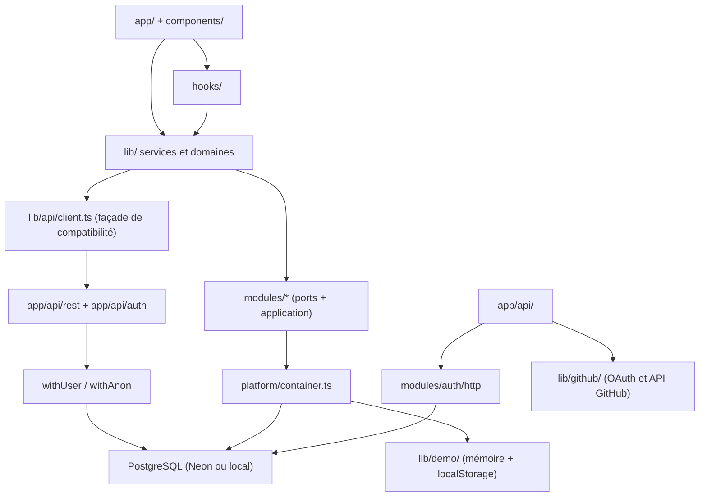
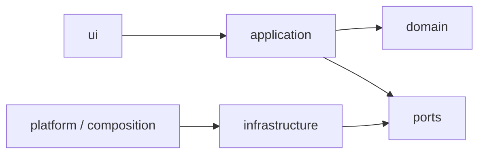

# Architecture de DevNet

> État vérifié le 15 novembre 2026, branche
> `feature/status-editor-liquid-glass`, commit `ec08ae9`. Ce document décrit
> le dépôt actuel et la direction retenue ; il ne présente pas la cible comme
> déjà livrée.

## État actuel

DevNet est un monolithe Next.js App Router : les pages et routes vivent dans
`app/`, les composants d'interface dans `components/`, les hooks dans `hooks/`
et les services, modèles et règles partagées dans `lib/`. Le code est en
migration progressive à l'intérieur de ce monolithe.

Le socle de données n'est plus Supabase : les sessions, les lectures et les
écritures passent par PostgreSQL, soit directement dans les routes serveur,
soit par les routes `/api/rest` et `/api/auth`.



### Flux de données

- La lecture paginée du fil et la bascule du « J’aime » passent par un port :
  `app/feed` → `lib/social.ts` → `platform/container.ts` →
  `modules/feed/ports/FeedRepository` → adaptateur mémoire, REST ou HTTP.
- Les autres domaines migrés (`auth`, `events`, `messages`, `moderation`,
  `stickers`, `stories`) exposent leur propre API publique dans
  `modules/<domaine>/index.ts`. Le reste passe encore par
  `lib/api/client.ts`, qui envoie les requêtes vers `/api/rest` ou
  `/api/auth`.
- `lib/backend.ts` sonde `/api/backend-check`. Le proxy navigateur choisit le
  client REST ou `lib/demo/client.ts` ; le backend de démo conserve ses
  données localement et reproduit une partie de l'API utilisée par
  l'application.
- Les routes API lisent la session dans le cookie httpOnly `devnet_session`,
  puis exécutent les requêtes PostgreSQL avec `withUser` (RLS) ou `withAnon`.
- L'intégration GitHub est isolée sous `lib/github/` et `app/api/github/`.
  Son flux OAuth utilise un état scellé, un cookie httpOnly et un jeton
  chiffré. Les secrets restent côté serveur.
- Les règles métier pures (progression, notation, preuves, calculs) sont
  distinctes des appels réseau et doivent rester inchangées lors des
  migrations d'architecture, sauf besoin démontré et tests adaptés.

### Composition des domaines

| Domaine | Frontière | Infrastructure |
|---|---|---|
| `auth` | `modules/auth/ports` | PostgreSQL, OAuth, cookie de session |
| `events` | `modules/events/ports` | mémoire ou REST |
| `feed` | `modules/feed/ports` | mémoire, REST, HTTP |
| `messages` | `modules/messages/ports` | REST |
| `moderation` | `modules/moderation/ports` | REST, moteurs locaux |
| `stickers` | `modules/stickers/ports` | PostgreSQL / REST |
| `stories` | `modules/stories/ports` | PostgreSQL |

Les adaptateurs sont composés dans `platform/container.ts` et
`platform/auth-container.ts`. Un composant ne doit jamais importer
directement un adaptateur.

## Limites de l'architecture actuelle

- La façade `lib/api/client.ts` et le backend de démo facilitent la
  compatibilité, mais ne constituent pas encore des ports/adaptateurs formels
  pour tous les domaines.
- La logique de plusieurs services reste couplée au contrat PostgREST. Le mode
  mémoire n'est donc pas encore une preuve que toutes les fonctions serveur
  peuvent tourner sans service externe.
- Le mode démo est local au navigateur (notamment `localStorage`) et son bus
  temps réel ne couvre pas plusieurs onglets ou plusieurs instances serveur.
- Les routes qui utilisent les cookies serveur doivent vérifier la session
  côté serveur avant toute action liée à un utilisateur. Les identifiants
  fournis par le navigateur ne sont pas une preuve d'identité.
- La base de production est Neon. Le standby documenté est le pooler de la
  même base : il couvre la panne d'un endpoint, pas la perte de données.
  Les migrations distantes restent soumises à sauvegarde, simulation et
  confirmation explicite.

## Première tranche migrée : fil et « J’aime »

Le domaine `feed` expose deux cas d'usage derrière le même port :

```text
app/feed
  → lib/social.ts (compatibilité temporaire)
  → platform/container.ts (choix d'adaptateur)
  → modules/feed/application (lecture, enrichissement et bascule du « J’aime »)
  → modules/feed/ports/FeedRepository
  → infrastructure/memory, rest ou http
```

- Le contrat est dans `modules/feed/ports/` ; il ne contient aucun type SDK.
- `MemoryFeedRepository` s'appuie sur le moteur de démonstration existant.
- Les adaptateurs REST/HTTP encapsulent les lectures et écritures PostgREST.
  Ils sont transitoires et remplaçables ; la page n'importe aucun SDK.
- Le conteneur choisit la mémoire quand la démo est forcée, sans URL de
  backend, ou quand la sonde a déclaré le backend hors ligne en mode démo.
- Les erreurs de lecture du fil sont typées et affichées avec une action de
  reprise ; elles ne sont pas transformées en liste vide.
- La bascule du « J’aime » garde l'invariant existant : l'insertion d'une
  ligne est tentée en premier, seule une violation d'unicité déclenche son
  retrait, et les autres erreurs ne sont pas interprétées comme un « unlike ».
- Le test de contrat couvre pagination, ordre, portée suivie, cas vide,
  enrichissement, ajout/retrait du « J’aime » et erreurs des deux opérations.

Cette tranche ne déplace pas encore la création/modification/suppression des
publications, les commentaires, les autres domaines ou l'authentification.
`withAuthorXp` reste encore un service de l'ancien `lib/`, et les adaptateurs
de lecture reposent sur la façade de compatibilité historique.

## Trust & Safety

Les migrations `075` à `079` ajoutent les rôles de modération, les signalements,
les sanctions, les recours, la chaîne d'audit et les réglages de sécurité.
L'orchestration est dans `modules/moderation` et `lib/moderation/`, les moteurs
locaux dans `lib/security/`, et les écrans dans `app/admin/` et
`app/moderation/`. Les capacités réellement branchées sont décrites dans
[`engineering/TRUST-SAFETY-STATUS.md`](./engineering/TRUST-SAFETY-STATUS.md).

## Direction retenue

Évoluer progressivement vers un monolithe modulaire par domaine, sans
réécriture globale :

```text
app/                 routes et pages minces
modules/<domaine>/
  domain/            règles métier et modèles sans dépendance fournisseur
  application/       cas d'usage
  ports/             contrats requis/exposés par le domaine
  infrastructure/    adaptateurs propres au domaine
  ui/                interface du domaine
  index.ts           API publique du module
shared/              primitives réellement communes
platform/            configuration et composition des adaptateurs
```

Les dossiers actuels restent en place pendant la transition. Tout nouveau
domaine ou domaine migré doit avoir des frontières explicites et progresser par
tranche verticale, sans déplacer ni modifier les règles métier pures sans
nécessité. Un module ne doit être consommé que par son API publique.

### Ordre des dépendances visé



Les composants ne doivent pas dépendre directement d'un pilote de base de
données ni d'un SDK fournisseur. Les ports et adaptateurs sont introduits au
premier besoin réel, pas en anticipation.

## Séquence et limites de travail

1. Corriger et documenter les comportements applicatifs qui ne nécessitent pas
   de changement de schéma.
2. Introduire les frontières d'un domaine à la fois, en préservant ses
   comportements et en ajoutant des tests de contrat.
3. Le socle local est PostgreSQL 18.3, avec les 80 migrations du dépôt et un
   exécuteur en simulation par défaut. La production est Neon, avec TLS
   `verify-full`, rôles RLS et `search_path` explicite.
4. N'exécuter aucune migration, aucun `db:reset` et aucune opération sur une
   base distante sans sauvegarde, simulation et confirmation explicite.

Les compteurs de dépendances et l'état des validations sont suivis dans
[`BASELINE.md`](./BASELINE.md) ; ils doivent être recalculés avant chaque tranche
qui modifie ces frontières. L'exploitation, les sauvegardes et le diagnostic
sont décrits dans [`ops/runbook.md`](./ops/runbook.md).
