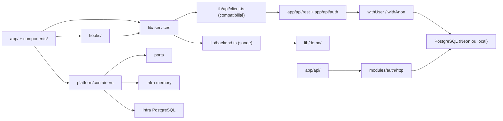

# DevNet — structure, couches et fondements

> État mesuré le 15 novembre 2026, branche
> `feature/status-editor-liquid-glass`, commit `ec08ae9`. Les chiffres de ce
> document viennent de commandes exécutées sur ce dépôt. Les décisions et leur
> historique sont dans [`ARCHITECTURE.md`](./ARCHITECTURE.md) ; l'état de
> référence des vérifications est dans [`BASELINE.md`](./BASELINE.md).

## 1. Ce qu'est DevNet

Un monolithe **Next.js App Router** en TypeScript strict : un seul déploiement
sert les pages, les routes API et les assets. Le produit est un réseau social
de développeurs où la publication, le code et le projet sont le même objet ;
le fil, le dépôt interne et GitHub partagent les mêmes types et les mêmes
règles.

Le dépôt n'est plus en transition depuis Supabase : l'application parle à
**PostgreSQL** via ses propres routes serveur. La migration par domaine
continue en revanche à l'intérieur de ce socle. Sept domaines ont une frontière
explicite (`auth`, `events`, `feed`, `messages`, `moderation`, `stickers`,
`stories`) ; les autres services passent encore par la façade de compatibilité
`lib/api/client.ts`.

## 2. Structure du dépôt

```text
app/                    37 pages, dont 19 layouts, 14 loading, 1 error,
                        1 global-error, 1 not-found
  api/                  70 routes serveur (auth, REST, push, stories, admin…)
  fonts/                Instrument Sans + IBM Plex Mono, auto-hébergées
  globals.css           tokens, thèmes, utilitaires, densité du fil
components/             116 fichiers d'interface
hooks/                  9 hooks (session, progression, requêtes, frappe…)
lib/                    170 fichiers : services, modèles, règles pures
  api/                  façades client/serveur et identité de session
  rest/                 client HTTP maison vers /api/rest
  demo/                 backend local de démonstration (PostgREST simulé)
  git/                  modèle d'objets git (blob, tree, commit, diff)
  github/               OAuth, chiffrement des jetons, synchronisation
  execution/            choix du moteur d'exécution et garde-fous
  push/                 abonnement, envoi et clés VAPID
modules/auth/           sessions, identité, inscription et connexion
modules/events/         bus d'événements applicatif
modules/feed/           domaine du fil : application, ports, adaptateurs
modules/messages/       messages, réactions, épingles, livraison
modules/moderation/     signalements, moteurs et sanctions
modules/stickers/       catalogue et assets de stickers
modules/stories/        stories, audience et vues
platform/               composition des adaptateurs et choix mémoire/PostgreSQL
db/migrations/          80 migrations SQL (001 → 081, sans 029)
db/compat/              couche de compatibilité PostgreSQL
scripts/                72 scripts `test-*`, migration, sauvegarde, audit
docs/                   architecture, design, UI, ADR, contrats, exploitation
proxy.ts                garde serveur de /admin (session + rôle, réponse 404)
```

Le dossier racine contient aussi des fichiers d'exploitation non versionnés
(tunnel, journaux, binaire Go, captures). Ils ne font pas partie du produit et
sont ignorés par git.

## 3. Les huit couches

| # | Couche | Où | Rôle | Ne doit jamais |
|---|---|---|---|---|
| 1 | Routes et pages | `app/**/page.tsx`, `app/layout.tsx` | Composition d'écran, gardes serveur, métadonnées | Contenir une règle métier ou un appel SDK direct |
| 2 | Interface | `components/`, `app/globals.css` | Rendu, états, gestes, accessibilité | Lire la base ou décider d'une autorisation |
| 3 | État de vue | `hooks/` | Session, requêtes, préférences, frappe | Devenir une seconde source de vérité métier |
| 4 | Services et règles | `lib/` | Cas d'usage, calculs purs, façades | Importer un composant ou une page |
| 5 | Ports | `modules/<domaine>/ports/`, `modules/*/index.ts` | Contrats sans type fournisseur | Exposer un type SDK |
| 6 | Adaptateurs | `modules/*/infrastructure/`, `platform/` | Mémoire, PostgreSQL | Fuir dans l'UI par un import direct |
| 7 | Données | `db/migrations/`, `db/compat/` | Schéma, politiques, index, compatibilité | Être appliqué à une base distante sans cible validée |
| 8 | Preuve | `scripts/`, `docs/BASELINE.md` | Suites de contrat, mesures, décisions | Affaiblir une assertion pour faire passer un build |

Les routes API (`app/api/`) sont une couche serveur à part : elles lisent la
session dans le cookie HTTP et exécutent leurs requêtes avec `withUser` (RLS)
ou `withAnon`. Un identifiant envoyé par le client n'est pas une preuve
d'identité.

## 4. Règle de dépendance



Cinq règles dures :

1. **Aucun SDK de fournisseur.** `lib/rest/client.ts` est l'unique porte vers
   `/api/rest` et `/api/auth` ; les noms `supabase` restent dans quelques
   commentaires historiques, pas dans les dépendances.
2. **La façade de compatibilité reste le point d'étranglement.** De nombreux
   fichiers importent encore `lib/api/client.ts` et ses appels `.from(`. C'est
   elle que les ports remplacent, domaine par domaine.
3. **Un module ne se consomme que par son API publique**
   (`modules/<domaine>/index.ts`).
4. **Les règles pures de `lib/` ne bougent pas** pendant une migration
   d'architecture : gamification, notation, preuves, git, recherche. Elles sont
   testées hors réseau et ne connaissent ni React ni fournisseur.
5. **L'UI ne décide pas d'une permission.** Elle masque une action qui
   échouerait ; la RLS et le serveur refusent réellement.

## 5. Le chemin d'une donnée

```text
app/feed (page)
  → lib/social.ts (façade métier de compatibilité)
  → platform/container.ts (choix d'adaptateur)
  → modules/feed/application/feed-service.ts (cas d'usage)
  → modules/feed/ports/feed-repository.ts (contrat)
  → infrastructure/memory | infrastructure/postgres
```

Le conteneur choisit la mémoire quand la démo est forcée, quand aucune URL de
backend n'existe, ou quand la sonde a déclaré le backend hors ligne en mode
démo. Les erreurs de lecture du fil sont typées et affichées avec une reprise :
elles ne deviennent jamais une liste vide.

Les autres domaines suivent encore le chemin historique
`page → lib/<service>.ts → lib/api/client.ts → /api/rest → PostgreSQL`. C'est
assumé : la migration se fait par tranche verticale, au premier besoin réel,
pas par réécriture globale. `modules/auth` fait exception : sa session est
résolue directement côté serveur depuis `public.sessions`.

## 6. Les fondements

1. **Le produit ne dépend d'aucun service pour démontrer.** `lib/backend.ts`
   sonde l'API ; sans réponse, `lib/demo/` implémente le sous-ensemble de
   PostgREST utilisé (mêmes méthodes, mêmes erreurs). Le bandeau dit
   explicitement qu'on est en démonstration : de fausses données non déclarées
   seraient un mensonge du produit.
2. **Aucune surface fantôme.** Un bouton agit, ou il est désactivé avec sa
   raison affichée. Les alertes écran verrouillé ne s'activent que si les clés
   VAPID sont présentes et si l'appareil le permet ; sinon le texte dit pourquoi.
3. **La donnée réelle avant la décoration.** Une publication sans dépôt
   n'affiche pas d'emplacement vide ; un nom de fichier n'apparaît que s'il
   existe ; une série de graphique dit son plafond d'échantillonnage.
4. **Le score se recalcule, il ne se stocke pas.** Pas de colonne `users.xp` :
   la progression est dérivée des événements réels, donc elle ne peut pas
   mentir et ne laisse pas de score fantôme après suppression.
5. **Le dépôt DevNet est la source de vérité.** GitHub est une destination.
   Quand les deux côtés ont divergé, le plan refuse de choisir : une fusion
   automatique donnerait l'illusion que tout va bien alors qu'une modification
   est perdue.
6. **Chaque personne pousse avec son propre jeton.** Le jeton GitHub est chiffré
   (HKDF, préfixe de version, période de grâce) et la RLS n'ouvre la connexion
   qu'à son propriétaire.
7. **Mobile d'abord, réseau lent d'abord.** Colonne de lecture unique, « Charger
   plus » explicite au lieu du défilement infini, polices locales servies par
   `next/font/local`, pas de CDN d'icônes.
8. **Le design vient de la structure.** Marge, filets, heure en gouttière et
   typographie séparent conversation, code et annotation ; aucune couleur
   supplémentaire n'est ajoutée pour distinguer les registres. Voir
   [`design-log.md`](./design-log.md).
9. **La preuve passe avant l'annonce.** Une migration non appliquée est dite
   non appliquée ; un score Lighthouse non mesuré n'est pas publié ; une
   vérification qui n'a pas tourné n'est pas un « ✅ ».
10. **On migre un domaine à la fois, avec un test de contrat.** Une tranche
    livre une frontière, ses tests et sa documentation ; elle ne déplace pas
    trois domaines en même temps.

## 7. Socle de données

- **80 migrations** dans `db/migrations/`, numérotées `001` à `081` ; `029`
  est absente du dépôt pour des raisons historiques. La base de production en
  compte 81, dont l'entrée orpheline `029_extensions.sql`.
- **PostgreSQL 18.3**, en local via `docker-compose.yml`, en production chez
  Neon. `db/compat/` fournit la couche de compatibilité nécessaire aux rôles et
  fonctions attendues par le schéma.
- Les routes serveur ouvrent leurs connexions avec `withUser` (RLS) ou
  `withAnon`. Le navigateur ne lit jamais la base directement.
- Les images de stories sont stockées dans `story_media` ; les autres médias
  passent par l'adaptateur R2 quand il est configuré, avec repli PostgreSQL.
  Un média n'est lisible que par les personnes autorisées à voir son objet.
- La cible Neon est mesurée : TLS `verify-full`, rôles RLS, `search_path`
  explicite. `db:reset` refuse par conception tout hôte qui n'est pas local.
- Le standby documenté est le pooler de la **même** base Neon : il protège
  d'une panne d'endpoint, pas d'une perte de données. Voir
  [`ops/failover.md`](./ops/failover.md).

## 8. Sécurité et identité

| Sujet | Où | Règle |
|---|---|---|
| Session | cookie httpOnly `devnet_session`, `public.sessions` | Vérifiée côté serveur avant toute action liée à un utilisateur |
| Admin | `proxy.ts` + `app/admin/layout.tsx` | Double garde : `is_admin` lu en base, réponse **404** et `noindex` pour ne pas révéler l'existence de la console |
| Secrets | `lib/github/crypto.ts`, routes API | Jamais dans le bundle client ; jeton chiffré, clé dérivée d'une variable serveur |
| RLS | `db/migrations/` | Source de vérité des permissions ; l'UI ne fait qu'éviter une action qui échouerait |
| Média | `db/migrations/` + routes `media` | Type, taille et propriétaire vérifiés côté serveur |
| Démo | `lib/demo/` | Aucun secret, données locales au navigateur, bandeau visible |

## 9. Vérification

```bash
npx tsc --noEmit     # types stricts
npm run lint         # ESLint 9
npm test             # 56 suites unitaires et de contrat
npm run build        # build de production
npm run verify:ui    # lint UI, mouvement, cliquet UX
npm run test:ecran   # navigateur + téléphone (Playwright)
```

Le contrat social du dépôt : une tranche n'est pas terminée tant que le
typecheck, le lint ciblé, les suites concernées et le build n'ont pas été
relancés après la dernière modification. Un test affaibli pour passer n'est pas
une preuve.

## 10. Où poser quoi

| Besoin | Emplacement | À ne pas faire |
|---|---|---|
| Nouvel écran | `app/<route>/page.tsx` + entrée dans `lib/navigation.ts` | Ajouter un lien dans la coque sans route réelle |
| État ou requête réutilisable | `hooks/` | Dupliquer un `useEffect` de session par carte |
| Règle métier | `lib/` en fonction pure testable | Mélanger calcul et appel réseau |
| Nouveau domaine | `modules/<domaine>/{domain,application,ports,infrastructure}` | Laisser l'UI importer l'adaptateur |
| Choix d'implémentation | `platform/container.ts` | Décider du backend dans un composant |
| Schéma | nouvelle migration dans `db/migrations/` | Modifier une migration déjà appliquée |
| Preuve | `scripts/test-*.ts` + entrée dans `npm test` | Un script hors suite qui ne tourne jamais |
| Décision d'architecture | `docs/adr/` | Une décision seulement racontée dans un message |

## 11. Dette mesurée et limites

- **Sept domaines** ont des ports/adaptateurs ; le reste passe encore par la
  façade `lib/api/client.ts` et ses appels `.from(`. C'est le vrai chantier de
  migration, pas les imports SDK.
- **Pas d'i18n** : tout est en français dans le code, `<html lang="fr">`.
- **Pas de page 403 dédiée ni de mode hors-ligne complet** ; les états
  d'erreur, de chargement et de démonstration existent écran par écran.
- **Le mode démo est local au navigateur** : son bus temps réel ne couvre pas
  plusieurs onglets, et il ne prouve pas que toutes les fonctions serveur
  tournent sans service externe.
- **La preuve média réelle reste partielle** : les secrets R2 ne sont pas
  disponibles dans tous les environnements, même si le repli PostgreSQL est
  testé.
- **Le cliquet UX est un plafond** : 489 valeurs Tailwind arbitraires mesurées
  pour un plafond de 493 au 15 novembre 2026.

## 12. Documents liés

- [`ARCHITECTURE.md`](./ARCHITECTURE.md) — décisions, historique de migration, séquence.
- [`BASELINE.md`](./BASELINE.md) — mesures de la Phase 0, compteurs de référence.
- [`design-log.md`](./design-log.md) — journal de design et fusion des directions.
- [`adr/`](./adr/) — décisions ponctuelles (base de données, exécuteur, premier port).
- [`ui/`](./ui/) — inventaire et matrice de couverture des surfaces.
- [`maintenance/DEVNET-CONTENT-AUDIT.md`](./maintenance/DEVNET-CONTENT-AUDIT.md) — audit de véracité en cours.
