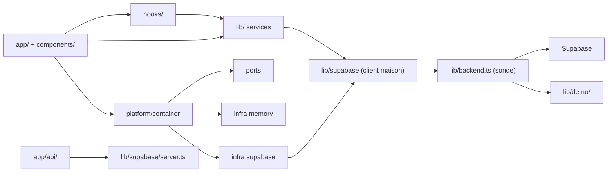

> **Note 2026-11-08** : instantané historique. Le miroir local est PostgreSQL 18.3, les migrations vont jusqu’à 044, et la procédure d’exploitation est dans `docs/ops/`.

# DevNet — structure, couches et fondements

> État mesuré le 4 novembre 2026 sur `refactor/independence`, Node 22, Next.js
> 16.3.8. Les chiffres de ce document viennent de commandes exécutées sur ce
> dépôt, pas d'une note antérieure. Les décisions d'architecture et leur
> historique sont dans [`ARCHITECTURE.md`](./ARCHITECTURE.md) ; l'état de
> référence des vérifications est dans [`BASELINE.md`](./BASELINE.md).

## 1. Ce qu'est DevNet

Un monolithe **Next.js App Router** en TypeScript strict : un seul déploiement
sert les pages, les routes API et les assets. Le produit est un réseau social
de développeurs africains où la publication, le code et le projet sont le même
objet ; l'architecture suit cette thèse — le fil, le dépôt interne et GitHub
partagent les mêmes types et les mêmes règles.

Le dépôt est en **transition** : la majorité des services parle encore à
Supabase via un client maison, tandis qu'un premier domaine (`feed`) est déjà
découpé en ports/adaptateurs. Ce document décrit les deux états, et dit lequel
fait autorité quand ils diffèrent.

## 2. Structure du dépôt

```text
app/                    36 pages, 2 layouts, 15 loading, 1 error, 1 not-found
  api/                  15 routes serveur (admin, backend-check, GitHub)
  fonts/                Instrument Sans + IBM Plex Mono, auto-hébergées
  globals.css           tokens, thèmes, utilitaires, densité du fil
components/             70 composants racine, 72 avec les sous-dossiers
hooks/                  9 hooks (session, progression, requêtes, frappe…)
lib/                    67 fichiers : services, modèles, règles pures
  demo/                 backend local de démonstration (PostgREST simulé)
  git/                  modèle d'objets git (blob, tree, commit, diff)
  supabase/             client navigateur, client serveur, résolution de profil
  github/               OAuth, chiffrement des jetons, plan de synchronisation
  execution/            choix du moteur d'exécution et garde-fous
modules/feed/           domaine du fil : application, ports, adaptateurs mémoire/Supabase
modules/moderation/     domaine des signalements : service, port, adaptateur Supabase
modules/messages/       domaine messages : réactions, épingles, suppression
platform/container.ts   composition des adaptateurs et choix mémoire/Supabase
supabase/               41 migrations SQL (001 → 041) + seed + migrations/ dupliquées
db/compat/              couche de compatibilité PostgreSQL pour un serveur vierge
scripts/                42 suites de tests, scripts de migration et de capture
docs/                   architecture, design, UI, ADR, contrats de surface
proxy.ts                garde serveur de /admin (session + rôle, réponse 404)
modules/ + platform/    frontières cibles ; le reste migre domaine par domaine
```

Le dossier racine contient aussi des fichiers d'exploitation non versionnés
(tunnel, journaux, binaire Go, captures). Ils ne font pas partie du produit et
sont ignorés par git.

## 3. Les huit couches

| # | Couche | Où | Rôle | Ne doit jamais |
|---|---|---|---|---|
| 1 | Routes et pages | `app/**/page.tsx`, `app/layout.tsx` | Composition d'écran, gardes serveur, métadonnées | Contenir une règle métier ou un appel SDK direct |
| 2 | Interface | `components/`, `app/globals.css` | Rendu, états, gestes, accessibilité | Lire la base ou décider d'une autorisation |
| 3 | État de vue | `hooks/` | Session, requêtes, préférences, frappe | Devenir une seconde source de vérité métier |
| 4 | Services et règles | `lib/` | Cas d'usage, calculs purs, façades | Importer un composant ou une page |
| 5 | Ports | `modules/<domaine>/ports/`, `modules/*/index.ts` | Contrats sans type fournisseur | Exposer un type SDK |
| 6 | Adaptateurs | `modules/*/infrastructure/`, `platform/` | Mémoire, Supabase, futur PostgreSQL | Fuir dans l'UI par un import direct |
| 7 | Données | `supabase/`, `db/` | Schéma, politiques, index, compatibilité | Être appliqué à une base distante sans cible validée |
| 8 | Preuve | `scripts/`, `docs/BASELINE.md` | Suites de contrat, mesures, décisions | Affaiblir une assertion pour faire passer un build |

Les routes API (`app/api/`) sont une couche serveur à part : elles créent leur
propre client à partir des cookies HTTP et ne partagent pas la session du
navigateur. Une route qui agit sur un utilisateur vérifie la session côté
serveur — un identifiant envoyé par le client n'est pas une preuve d'identité.

## 4. Règle de dépendance



Cinq règles dures :

1. **Une seule porte vers le fournisseur.** Quatre fichiers importent
   `@supabase/*` : `lib/supabase/client.ts`, `lib/supabase/server.ts`,
   `hooks/useSession.ts` et `app/api/admin/accounts/route.ts`. Toute nouvelle
   dépendance directe au SDK est un recul.
2. **Le client maison reste le point d'étranglement.** 53 fichiers l'importent
   et on compte 310 appels `.from(`. C'est cette façade que les ports
   remplacent, pas les imports SDK.
3. **Un module ne se consomme que par son API publique** (`modules/<domaine>/index.ts`).
4. **Les règles pures de `lib/` ne bougent pas** pendant une migration
   d'architecture : gamification, notation, preuves, git, recherche. Elles sont
   testées hors réseau et ne connaissent ni React ni fournisseur.
5. **L'UI ne décide pas d'une permission.** Elle masque une action qui
   échouerait ; la RLS et le serveur refusent réellement.

## 5. Le chemin d'une donnée

```text
app/feed (page)
  → lib/social.ts (façade de compatibilité)
  → platform/container.ts (choix d'adaptateur)
  → modules/feed/application/feed-service.ts (cas d'usage)
  → modules/feed/ports/feed-repository.ts (contrat)
  → infrastructure/memory | infrastructure/supabase
```

Le conteneur choisit la mémoire quand la démo est forcée, quand aucune URL de
backend n'existe, ou quand la sonde a déclaré le backend hors ligne en mode
démo. Les erreurs de lecture du fil sont typées et affichées avec une reprise :
elles ne deviennent jamais une liste vide.

Les autres domaines suivent encore le chemin historique
`page → lib/<service>.ts → lib/supabase/client.ts → backend`. C'est assumé :
la migration se fait par tranche verticale, au premier besoin réel, pas par
réécriture globale.

## 6. Les fondements

1. **Le produit ne dépend d'aucun service pour démontrer.** `lib/backend.ts`
   sonde l'API ; sans réponse, `lib/demo/` implémente le sous-ensemble de
   PostgREST utilisé (mêmes méthodes, mêmes erreurs). Le bandeau dit
   explicitement qu'on est en démonstration : de fausses données non déclarées
   seraient un mensonge du produit.
2. **Aucune surface fantôme.** Un bouton agit, ou il est désactivé avec sa
   raison affichée. C'est pourquoi les réglages n'exposent ni email ni push, et
   pourquoi la console admin ne propose pas de bascule qu'aucun service ne lit.
3. **La donnée réelle avant la décoration.** Une publication sans dépôt
   n'affiche pas d'emplacement vide ; un nom de fichier n'apparaît que s'il
   existe ; une série de graphique dit son plafond d'échantillonnage.
4. **Le score se recalcule, il ne se stocke pas.** Pas de colonne `users.xp` :
   la progression est dérivée des événements réels, donc elle ne peut pas
   mentir et ne laisse pas de score fantôme après suppression.
5. **Le dépôt DevNet est la source de vérité.** GitHub est une destination.
   Quand les deux côtés ont divergé, le plan refuse de choisir : une fusion
   automatique donnerait l'illusion que tout va bien alors qu'une modification
   est perdue.
6. **Chaque personne pousse avec son propre jeton.** Le jeton GitHub est chiffré
   (HKDF, préfixe de version, période de grâce) et la RLS n'ouvre la connexion
   qu'à son propriétaire.
7. **Mobile d'abord, réseau lent d'abord.** Colonne de lecture unique, « Charger
   plus » explicite au lieu du défilement infini, polices locales servies par
   `next/font/local`, pas de CDN d'icônes.
8. **Le design vient de la structure.** Marge, filets, heure en gouttière et
   typographie séparent conversation, code et annotation ; aucune couleur
   supplémentaire n'est ajoutée pour distinguer les registres. Voir
   [`design-log.md`](./design-log.md).
9. **La preuve passe avant l'annonce.** Une migration non appliquée est dite
   non appliquée ; un score Lighthouse non mesuré n'est pas publié ; une
   vérification qui n'a pas tourné n'est pas un « ✅ ».
10. **On migre un domaine à la fois, avec un test de contrat.** Une tranche
    livre une frontière, ses tests et sa documentation ; elle ne déplace pas
    trois domaines en même temps.

## 7. Socle de données

- **51 migrations** `supabase/001…051`, plus `seed.sql`, soit **52 entrées**
  avec `000_compat.sql`. Elles supposent Supabase : `auth.uid()`, rôles
  `anon`/`authenticated`, schéma `extensions`, publication
  `supabase_realtime`.
- `db/compat/000_compat.sql` fournit la couche de compatibilité pour un
  PostgreSQL vierge ; `docker-compose.yml` et `scripts/db/` servent les essais
  locaux (PostgreSQL 18.3).
- **Deux copies** des migrations existent (`supabase/*.sql` et
  `supabase/migrations/`). L'exécuteur lit la racine `supabase/` ; l'autre
  dossier est un héritage à ne pas utiliser pour une nouvelle migration, sous
  peine de divergence silencieuse.
- La cible Systalink **est mesurée et migrée** : PostgreSQL 18.3, TLS 1.3,
  52 migrations appliquées le 2026-11-09, rôles RLS créés. L'application utilise
  encore Supabase ; aucune donnée réelle n'a été basculée. `db:reset` refuse
  par conception tout hôte qui n'est pas local.

## 8. Sécurité et identité

| Sujet | Où | Règle |
|---|---|---|
| Session | cookies Supabase, `lib/supabase/server.ts` | Vérifiée côté serveur avant toute action liée à un utilisateur |
| Admin | `proxy.ts` + `app/admin/layout.tsx` | Double garde : `is_admin` lu en base, réponse **404** et `noindex` pour ne pas révéler l'existence de la console |
| Secrets | `lib/github/crypto.ts`, routes API | Jamais dans le bundle client ; jeton chiffré, clé dérivée d'une variable serveur |
| RLS | `supabase/*.sql` | Source de vérité des permissions ; l'UI ne fait qu'éviter une action qui échouerait |
| Démo | `lib/demo/` | Aucun secret, données locales au navigateur, bandeau visible |

## 9. Vérification

```bash
npx tsc --noEmit     # types stricts
npm run lint         # ESLint 9
npm test             # 42 suites unitaires et de contrat
npm run build        # build de production, sans réseau
npm run test:ecran   # parcours navigateur + téléphone (Python/Playwright)
```

Le contrat social du dépôt : une tranche n'est pas terminée tant que le
typecheck, le lint ciblé, les suites concernées et le build n'ont pas été
relancés après la dernière modification. Un test affaibli pour passer n'est pas
une preuve.

## 10. Où poser quoi

| Besoin | Emplacement | À ne pas faire |
|---|---|---|
| Nouvel écran | `app/<route>/page.tsx` + entrée dans `lib/navigation.ts` | Ajouter un lien dans la coque sans route réelle |
| État ou requête réutilisable | `hooks/` | Dupliquer un `useEffect` de session par carte |
| Règle métier | `lib/` en fonction pure testable | Mélanger calcul et appel réseau |
| Nouveau domaine | `modules/<domaine>/{domain,application,ports,infrastructure}` | Laisser l'UI importer l'adaptateur |
| Choix d'implémentation | `platform/container.ts` | Décider du backend dans un composant |
| Schéma | `supabase/042_*.sql` (et sa copie) | Modifier une migration déjà appliquée |
| Preuve | `scripts/test-*.ts` + entrée dans `npm test` | Un script hors suite qui ne tourne jamais |
| Décision d'architecture | `docs/adr/` | Une décision seulement racontée dans un message |

## 11. Dette mesurée et limites

- **Trois domaines** en ports/adaptateurs (`feed`, `moderation`, `messages`) ;
  le fil et les autres services passent encore massivement par `lib/social.ts`
  et le client maison. Les façades `lib/reports.ts` et `lib/messages.ts` ne
  contiennent plus de requête : elles gardent les libellés et les types, et
  délèguent aux services des domaines.
- **53 fichiers** passent par le client maison et **310** appels `.from(` :
  la façade est le vrai chantier de migration, pas les imports SDK.
- **Pas d'i18n** : tout est en français dans le code, `<html lang="fr">`.
- **Pas de `global-error.tsx`**, pas de pages 403, 500, hors-ligne, session
  expirée ni limite de débit. L'inventaire complet est dans
  [`docs/ui/inventory.md`](./ui/inventory.md) et la matrice des 199 surfaces
  dans [`docs/ui/coverage.md`](./ui/coverage.md).
- **Un seul contrat de surface** (`docs/ui-contracts/admin-console.md`) ; les
  surfaces de sécurité, d'audit et d'administration ne sont pas instrumentées.
- **Le mode démo est local au navigateur** : son bus temps réel ne couvre pas
  plusieurs onglets, et il ne prouve pas que toutes les fonctions serveur
  tournent sans service externe.

## 12. Documents liés

- [`ARCHITECTURE.md`](./ARCHITECTURE.md) — décisions, historique de migration, séquence.
- [`BASELINE.md`](./BASELINE.md) — mesures de la Phase 0, compteurs de référence.
- [`design-log.md`](./design-log.md) — journal de design et fusion des directions.
- [`adr/`](./adr/) — décisions ponctuelles (base de données, exécuteur, premier port).
- [`ui/`](./ui/) — inventaire et matrice de couverture des surfaces.
